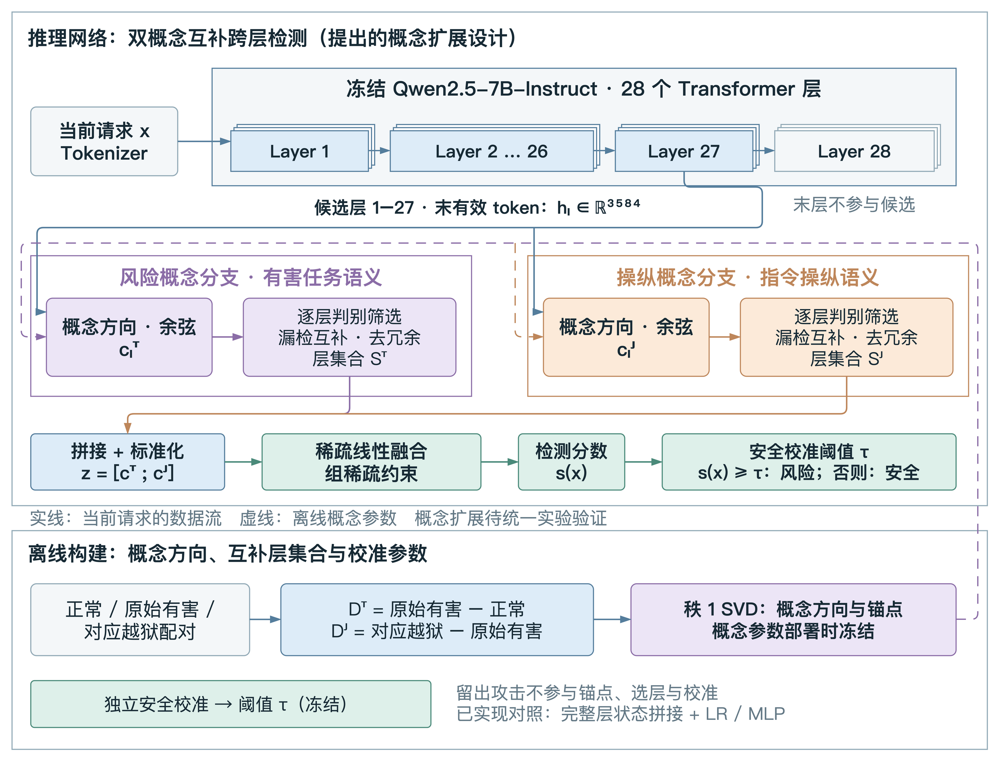

# 对未见越狱攻击类型的双概念融合检测

本项目实现期中报告第二项研究的实验主线：冻结大模型，分别读取任务风险与攻击操纵概念，为两类概念选择互补层，再通过组稀疏线性头融合检测。代码包暂用描述性名称 `dual_concept`，项目目录仍保留原路径。



当前训练、校准、缓存和推理入口均已实现。随项目提供的是1665条已暴露开发样本及其配对，标签尚未独立核验。真实Qwen2.5-7B训练与新的独立确认实验需要在具备模型权重和计算资源的环境执行，历史结果不代表该实现的性能。

## 安装

Python 3.10或以上。拟合缓存状态及运行数学测试仅需NumPy：

```bash
python -m venv .venv
source .venv/bin/activate
python -m pip install -e .
```

需要提取大模型状态或原始文本推理时安装模型依赖。在GPU服务器按CUDA环境安装PyTorch，再安装其余依赖：

```bash
python -m pip install -e '.[model]'
```

以下命令从项目根目录执行。安装后也可使用 `dual-concept` 命令。

## 实验流程

检查数据哈希、任务组隔离和配对完整性：

```bash
python -m dual_concept validate --data data
```

在 `configs/qwen2_5_7b.json` 配置模型、设备和精度，再提取状态。也可指定本地模型目录：

```bash
python -m dual_concept extract --data data --config configs/qwen2_5_7b.json --model-path /path/to/Qwen2.5-7B-Instruct --cache artifacts/states
```

逐ID缓存支持同协议断点续跑。使用聊天模板与generation prefix，在末个非填充位置读取1—27层；不生成回答、不修改主干。超长输入明确报错，不静默截断。文本、模型/分词器、精度、层号和版本均绑定缓存协议。

拟合双概念、分别选层、组稀疏融合与安全阈值：

```bash
python -m dual_concept train --data data --config configs/qwen2_5_7b.json --cache artifacts/states --output artifacts/runs/full
```

每个内部攻击类型留出折都会重建概念，排除该类型训练攻击及其操纵配对，再评价选择集中该类型的样本。每分支至少2层、至多4层；合格层不足或融合未收敛时停止并说明原因。默认超参数是可配置的实现起点，尚未证明最优。

外层攻击类型留出实验重新拟合整个检测器，例如AutoDAN：

```bash
python -m dual_concept train --data data --cache artifacts/states --output artifacts/runs/holdout_autodan --holdout autodan
```

GCG/nanoGCG合并为 `gcg`，PAIR/TAP合并为 `pair_tap`。留出的攻击输入不参与概念、锚点、选层、标准化、融合或校准；原始有害目标可继续作为风险监督。该协议检验攻击类型迁移，不宣称严格语义主题留出。

单独评价冻结模型，不重新校准：

```bash
python -m dual_concept evaluate --data data --model artifacts/runs/holdout_autodan --cache artifacts/states --split diagnose --output artifacts/runs/holdout_autodan/diagnose.json
```

报告总体、请求类别及攻击族的计数、TPR、FPR和AUROC。每种实验使用新的输出目录。`diagnose`已暴露，不能据此宣布独立泛化结果；新增独立材料并冻结参数后，可使用相同schema的 `development/confirm.jsonl` 与 `--split confirm`。

新请求检测：

```bash
python -m dual_concept predict --model artifacts/runs/full --text '请解释如何识别并防范网络钓鱼。'
```

批量使用 `--input requests.jsonl`，每行包含 `text` 和可选 `id`。输出线性logit与 `risk`，统一采用 `logit >= threshold`。模型仍完成主干前向，少量读出层未实现提前退出。

## 数据与方法

| 角色 | 条数 | 用途 |
| --- | ---: | --- |
| train | 866 | 概念、锚点、标准化与融合参数 |
| select | 439 | 内部攻击类型分组验证与分别选层 |
| calibrate | 140 | 仅安全候选，确定最终阈值 |
| diagnose | 220 | 已暴露开发诊断，不参与拟合 |

另有一个单独的 [`JBB 100 目标组来源锁定试点`](data/dccf_v1_jbb_pilot/)，包含待审核候选、H-B 匹配候选和已发布 J-H 来源链接。它尚未完成双人语义审核、重叠检查及分区，因此不是可训练或可评测数据；详见[构建方案](docs/DATASET_CONSTRUCTION_PLAN_V1.md)。

风险训练对200组，操纵对260组（训练200、选择40、诊断20）。5%预算在140条安全校准样本上最多允许7条误报；测试FPR另行报告。

- [完整方法与实现约定](docs/METHOD.md)
- [数据来源、字段及标签限制](data/README.md)
- [旧项目清理及恢复说明](docs/MIGRATION.md)
- [本次验证记录](docs/VALIDATION.md)

## 目录

```text
dual_concept/
  backbone.py     冻结主干、末有效token、协议绑定缓存
  data.py         数据schema、配对、分区隔离与类型留出
  concepts.py     配对差分秩1方向、锚点及余弦
  selection.py    分别选层、漏检补偿与去冗余
  fusion.py       训练标准化及物理层组稀疏线性头
  evaluation.py   安全校准与分组指标
  pipeline.py     训练边界与冻结参数保存加载
  cli.py          统一实验命令
configs/          模型和方法参数
data/             当前主线开发材料与配对
tests/            数值、协议与端到端验证
tools/            一次性旧数据迁移工具
docs/             方法、迁移和验证记录
```

## 验证

```bash
python -m unittest discover -s tests -v
python -m dual_concept validate
```

模型集成测试使用本地创建的微型随机Qwen和分词器，不下载7B权重；未安装模型依赖时自动跳过该项。可控样本测试验证实现和隔离协议，不提供真实攻击检测性能结论。
